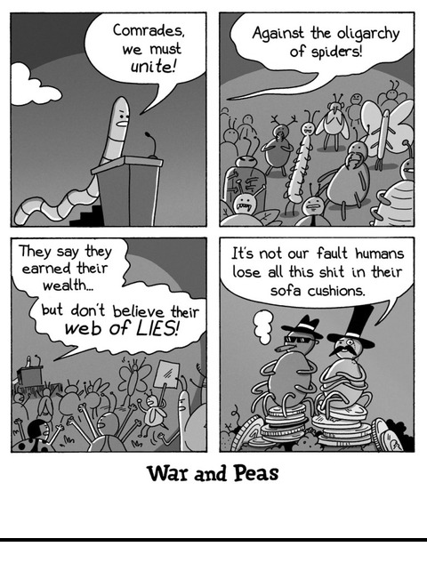

# thermalcomics
A Python script to download webcomics from ***Loading Artist***, ***Sarah Andersen***, ***XKCD*** and ***War and Peas***, and prepare them for 5.5mm thermal paper printing.

## What is it?

The script parses the above-mentioned webcomics and downloads a range. By default *50 comics from each artists are downloaded*, so the range you specify could be - for example - "150-200". In this case only those 50 comics will be downloaded, ignoring the first 150. The script prompts you to pick a range when run.

Files are downloaded in separate folders under **~/Pictures/webcomics/**. The script verbosely shows what is downloaded and when. Filenames are numbered and contain the name of the comic. All downloaded files are in `JPG` format and processed so that they'll all be **grayscale**, high-res, ready for print.

Tip: you can use `convert *.jpg comics_file.pdf` in any of the comic directories to make a PDF of all those files, easy for print. Or you can print each JPG individually.

Each downloaded comic has a *50px* indent at the bottom, followed by a *4px* thick line and another *50px* empty space. When printing them all this marks the beginning and ending of each comic strip.

The script does ***not*** print the files or make a PDF out of them.

***This script was made by Antigravity CLI. It is not my work. Feel free to do with it as you please. I just needed it and thought others might need it too.***

## Example

## Printed result

